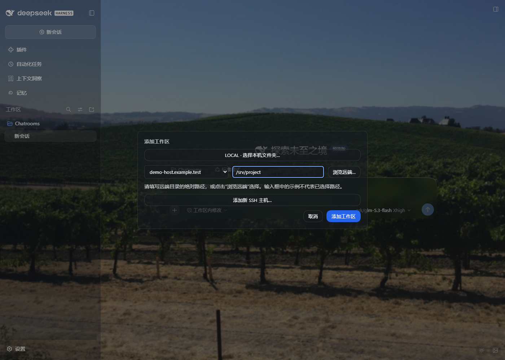
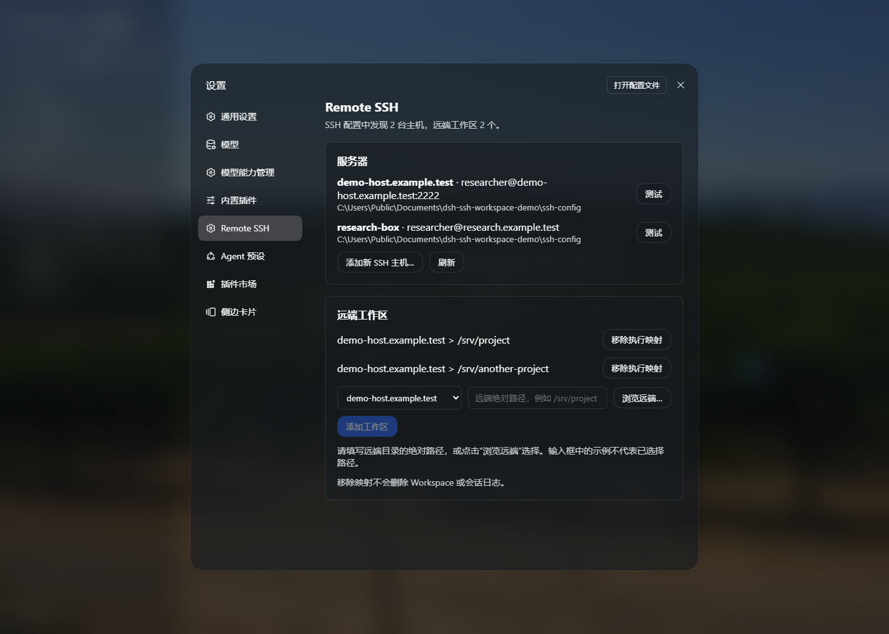

# SSH Workspace for DeepSeek Harness

[中文](README.zh.md) · [Download](https://github.com/ahian-lee/dsh-ssh-workspace/releases/latest)

**Unofficial community plugin.** Maintained by ahian-lee; derived from [Yan-Zero/dsh-remote-ssh](https://github.com/Yan-Zero/dsh-remote-ssh), under Apache-2.0.

Use a Linux SSH project as a regular workspace in DSH Desktop. Pick a host and a remote directory, then use the usual file, search and Bash tools in that workspace.

**DSH, its conversation runtime, model requests and plugins stay on your local computer.** Supported workspace file operations, search, subprocesses and Bash run through SSH on the selected host. Installing this plugin does not install a different DSH version or move every plugin to the server.



## What it provides

- Discover OpenSSH hosts, including `Include` and `ProxyJump`; add a host from the workspace picker or Settings → Remote SSH.
- Choose a local folder with DSH's native picker, or browse/type an absolute remote directory.
- Give each remote project its own normal workspace and conversation history.
- Route supported files, search and Bash to the selected SSH host without a separate `remote_*` tool set. Failed or removed remote mappings do not fall back to local execution.
- Preserve the shipped local sandbox provider and the user's default permission settings.
- Show readable primary buttons and an explicit explanation when an empty remote path disables workspace creation.



Screenshots use demonstration host names and directories, not a bundled host configuration.

## Compatibility

Validated on **Windows DSH Desktop 0.2.0-rc.2**, with Linux/POSIX remote hosts and Node.js 22+. The bundle currently uses the Windows local PowerShell sandbox provider. Linux/macOS local hosts, Windows remote hosts, the optional legacy TUI adapter and full remote DSH backend are **not supported by this release**.

This fork adapts the upstream 0.2.4 plugin to DSH's 0.2 Desktop service, settings, shell execution and UI slot APIs. It is not an upstream release.

## Install

In **DSH Desktop → Plugins**, install this prebuilt package URL, then completely exit and reopen DSH:

```text
https://github.com/ahian-lee/dsh-ssh-workspace/releases/latest/download/dsh-ssh-workspace.tgz
```

The release package contains compiled `lib/` files, the client module and `cordis.patch.yml`; no source build is required. The repository also contains those compiled files for GitHub installs.

For a standalone CLI Web profile on a Windows host:

```sh
dsh plugin --profile web add https://github.com/ahian-lee/dsh-ssh-workspace/releases/latest/download/dsh-ssh-workspace.tgz
dsh web
```

The standalone CLI does not manage the Electron-owned `desktop` profile. Use Desktop's plugin manager for that profile.

**Replace an existing `dsh-remote-ssh` installation:** disable/remove that bundle before enabling `dsh-ssh-workspace`. Both replace the same execution providers and must not be enabled together. Existing catalog and workspace aliases remain under `~/.dsh/remote-ssh/`; switching the package name does not require deleting them. A separate SSH operations panel such as `dsh-ssh` can remain installed.

## First workspace

1. Confirm `ssh your-host` works in your terminal. Complete any host-key, password or MFA setup there first.
2. Click **Add workspace**, select an SSH host, and enter an absolute remote path such as `/home/user/project`, or click **Browse remote**. Placeholder example text is not an entered path.
3. Add the workspace and create a conversation in it. Settings → Remote SSH also supports host and workspace management.
4. For arbitrary remote Bash execution, explicitly select that conversation's **Full access** permission mode. Restrictive remote shell requests are rejected; the plugin does not silently relax them. Local defaults remain unchanged.

The SSH account's permissions apply to remote commands; the remote directory is a routing boundary, not an operating-system sandbox. Use an appropriately scoped SSH account when needed.

Remote hosts need OpenSSH, `bash`, `base64`, `mkfifo`, `rg`, and a compatible VS Code Agent Host/CLI or cached VS Code Server. Missing remote software is reported, not installed silently. An optional per-server `remoteRgCommand` in `~/.dsh/remote-ssh/config.json` can reuse an existing ripgrep binary outside `PATH`.

## Validation and development

The initial release passed **35 focused tests** covering routing, filesystem, current shell handles, catalog persistence, SSH config, path mapping, AHP negotiation, SOCKS and bundle composition. Its packed artifact was installed in a separate directory and loaded into a real DSH Desktop profile composition. Browser checks covered adding a host and workspace, empty-path disabled behavior and the four Agent presets. Live Linux SSH checks covered file reads, Bash `pwd` and ripgrep; no model inference request was needed.

```sh
pnpm install
pnpm run check
pnpm run pack:release
```

Use Node.js 24 and pnpm 11.7.0 for development. `test` selects the supported Desktop routing suite; retained upstream backend/TUI tests are outside this release's supported surface. `build` transpiles the source and bundles the browser entry; it is not a whole-project TypeScript typecheck. See [CHANGELOG.md](CHANGELOG.md), [DESKTOP-COMPAT.md](DESKTOP-COMPAT.md) and [NOTICE](NOTICE) for the changes and attribution.
